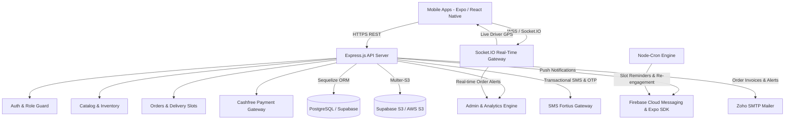
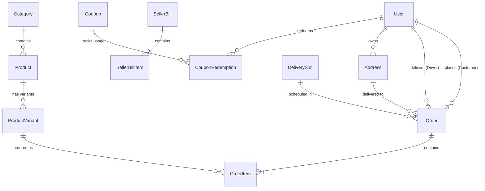

# 🥩 Daily Meat - Backend API & Server Documentation

Welcome to the **Daily Meat Backend** repository. This document serves as a comprehensive developer guide and handover manual for incoming engineering and freelance teams. It details the complete architecture, tech stack, data models, business workflows, configuration parameters, and deployment procedures.

---

## 📌 1. Project Overview

**Daily Meat** is an on-demand fresh meat delivery and supply chain platform. The backend is an enterprise-grade, event-driven REST and WebSocket server built on **Node.js (CommonJS)**, **Express.js**, and **PostgreSQL (hosted on Supabase)** using **Sequelize ORM**.

The system powers three primary user roles:
1. **Customers:** Browse categories, cuts, and products; manage delivery addresses; place orders with specific delivery slots; apply coupons; pay online via Cashfree or COD; and track delivery drivers on a live map in real time.
2. **Delivery Drivers:** Manage active deliveries, accept/reject assignments, navigate to pickup/customer locations, broadcast live GPS coordinates via WebSockets, and complete deliveries with OTP verification.
3. **Store Administrators:** Manage product catalog (cuts, variants, stock, pricing), store serviceability hours, delivery radius, pincodes, automated driver assignments, manual phone orders, customer support tickets, push campaigns, and seller bills/payouts.

---

## 🏗️ 2. System Architecture



---

## 💻 3. Technology Stack & External Integrations

| Layer / Service | Technology Used | Version / Details | Purpose |
| :--- | :--- | :--- | :--- |
| **Runtime** | Node.js | `>= 18.x` | Application execution environment |
| **Web Framework** | Express.js | `^5.2.1` | REST API routing and HTTP middleware |
| **Database & ORM** | PostgreSQL + Sequelize | `pg ^8.21.0`, `sequelize ^6.37.8` | Relational database (Supabase pooler) |
| **Real-Time Gateway** | Socket.IO | `^4.8.3` | Live driver GPS tracking & room broadcasts |
| **Object Storage** | AWS S3 SDK / Multer-S3 | `@aws-sdk/client-s3 ^3.0.0`, `multer-s3` | Product images, banners, and uploads (Supabase S3) |
| **Fallback Storage** | Cloudinary | `cloudinary ^1.41.3` | Alternative image CDN storage |
| **Payment Gateway** | Cashfree Payments | Production REST API & Webhooks | UPI, Cards, NetBanking, and auto-verification |
| **Authentication** | JWT & Bcrypt | `jsonwebtoken ^9.0.3`, `bcrypt ^6.0.0` | Access/Refresh tokens & secure password hashing |
| **Push Notifications** | Firebase Admin & Expo SDK | `expo-server-sdk ^6.1.0`, Base64 Service Account | Multi-device push alerts (Order updates, promos) |
| **SMS Gateway** | SMS Fortius | DLT Template ID API | OTP phone logins & transactional order SMS |
| **Email Service** | Nodemailer | `nodemailer ^8.0.11` via Zoho SMTP | Order confirmation receipts & support alerts |
| **Task Scheduling** | Node-Cron | `node-cron ^4.2.1` | Slot reminder cron & customer re-engagement |
| **API Documentation**| Swagger UI | `swagger-ui-express ^5.0.1` | Interactive documentation at `/api-docs` |

---

## 📂 4. Project Directory Structure

```text
daily-meat-be/
├── .env                                 # Local environment variables (DO NOT COMMIT)
├── .env.example                         # Environment configuration template
├── package.json                         # Project dependencies & operational scripts
├── HLD.md                               # High-Level Design & System Architecture manual
├── LLD.md                               # Low-Level Design & Database Schema specifications
├── DESIGN_HANDOVER.md                   # UI/UX Design tokens, screen maps & Figma guidelines
├── Daily_Meat_API.postman_collection.json # Ready-to-import complete Postman API collection (100 endpoints)
└── src/
    ├── app.js                           # Express application setup, CORS, JSON parsing, logging
    ├── server.js                        # HTTP server bootstrap, DB auth, WebSockets & cron init
    │
    ├── config/                          # Infrastructure configurations
    │   ├── cloudinary.js                # Cloudinary fallback configuration
    │   ├── database.js                  # Sequelize connection pooling & connection strings
    │   ├── socket.js                    # Socket.IO initialization, JWT handshake auth & room setup
    │   ├── swagger.js                   # Swagger JSDoc API documentation configuration
    │   └── upload.js                    # Multer storage engine supporting S3 (Supabase) & Cloudinary
    │
    ├── constants/                       # Global constants
    │   └── enum.js                      # User roles: CUSTOMER, DRIVER, ADMIN
    │
    ├── controllers/                     # Request handlers & HTTP business logic
    │   ├── addressController.js         # Customer delivery address CRUD & default toggle
    │   ├── adminController.js           # Admin dashboard metrics, inventory, drivers, users
    │   ├── adminCouponController.js     # Admin coupon creation, rules, discounts & validity
    │   ├── adminOrderCreationController.js # Manual / telephone order placement by admin
    │   ├── analysisController.js        # Sales revenue, category breakdown & order reports
    │   ├── authController.js            # Phone OTP request, verify, password login, refresh token
    │   ├── bannerController.js          # Promotional home sliders & banner images
    │   ├── catalogController.js         # Categories, products, cuts, variants & media
    │   ├── contactController.js         # Contact forms, customer inquiry handling
    │   ├── couponController.js          # Coupon validation, discount application for checkout
    │   ├── driverController.js          # Driver assignments, duty toggle, live delivery actions
    │   ├── healthController.js          # System health check endpoint
    │   ├── orderController.js           # Order creation, status progression, cancellation
    │   ├── paymentController.js         # Cashfree order session creation, verification & webhooks
    │   ├── sellerBillController.js      # Vendor/seller invoices & billing itemization
    │   └── shopSettingsController.js    # Store open/closed status, service radius, delivery slots
    │
    ├── middleware/                      # Express middlewares
    │   └── authMiddleware.js            # JWT verification & role-based route protection
    │
    ├── models/                          # Sequelize Database Models
    │   ├── index.js                     # Model associations & foreign key mappings
    │   ├── Address.js                   # Customer delivery addresses (lat, lng, street, pincode)
    │   ├── Banner.js                    # Promotional banners
    │   ├── Category.js                  # Product categories (Chicken, Mutton, Fish, etc.)
    │   ├── ContactMessage.js            # Support & contact messages
    │   ├── Coupon.js                    # Discount coupons (percentage/flat, min order, expiry)
    │   ├── CouponRedemption.js          # User-specific coupon usage records
    │   ├── DeliverySlot.js              # Time slots (e.g. 7 AM - 9 AM) and order capacities
    │   ├── Order.js                     # Central orders table (status, payment, totals, driver)
    │   ├── OrderItem.js                 # Order line items (product variant, qty, price)
    │   ├── Product.js                   # Products with descriptions, images, category link
    │   ├── ProductVariant.js            # SKUs/cuts (e.g., 500g Curry Cut, Boneless, Gross/Net wt)
    │   ├── SellerBill.js                # Vendor bill headers
    │   ├── SellerBillItem.js            # Vendor bill line items
    │   ├── ShopSettings.js              # Operational configuration (radius, min order, tax)
    │   ├── SupportTicket.js             # User dispute & issue ticketing
    │   └── User.js                      # Users (Customer, Driver, Admin) with phone, roles, credentials
    │
    ├── routes/                          # API Route Definitions
    │   ├── index.js                     # Root API router mounting all sub-routes at /api
    │   ├── addressRoutes.js             # /api/addresses
    │   ├── adminRoutes.js               # /api/admin
    │   ├── authRoutes.js                # /api/auth
    │   ├── catalogRoutes.js             # /api/catalog
    │   ├── contactRoutes.js             # /api/contact
    │   ├── couponRoutes.js              # /api/coupons
    │   ├── driverRoutes.js              # /api/driver
    │   ├── help.js                      # /api/help
    │   ├── orderRoutes.js               # /api/orders
    │   ├── paymentRoutes.js             # /api/payments
    │   └── shopSettingsRoutes.js        # /api/shop-settings
    │
    ├── scripts/                         # Maintenance, migration & test scripts
    │   ├── setupAdmin.js                # Script to create initial superadmin account
    │   ├── syncDb.js                    # Sequelize schema sync script
    │   ├── testPush.js                  # FCM/Expo push notification test utility
    │   └── testS3.js                    # S3/Supabase storage upload/download verification
    │
    ├── services/                        # Business logic & 3rd-party services
    │   ├── addressService.js            # Geocoding & address validation
    │   ├── authService.js               # Token generation, password hashing & OTP logic
    │   ├── catalogService.js            # Inventory, pricing & stock operations
    │   ├── couponService.js             # Cart discount evaluation & validation
    │   ├── emailService.js              # Nodemailer Zoho transport for transaction emails
    │   ├── notificationService.js       # Expo & Firebase push notification dispatch
    │   ├── paymentService.js            # Cashfree PG API interactions
    │   ├── reengagementCron.js          # Inactive user marketing re-engagement cron
    │   ├── slotNotificationCron.js      # Scheduled delivery slot reminder alerts
    │   └── smsService.js                # SMS Fortius HTTP integration for OTPs
    │
    └── utils/
        └── distanceCalc.js              # Haversine formula calculation for delivery distances
```

---

## 🗄️ 5. Database Schema & Key Associations

Sequelize manages the database models with strict associations configured in `src/models/index.js`:



### Key Models Description:
- **`User`**: Core account entity. Supports `CUSTOMER`, `DRIVER`, and `ADMIN`. Contains encrypted password, phone number, push notification token, and active duty status (`is_online` for drivers).
- **`Order`**: Tracks order states: `PENDING`, `CONFIRMED`, `PREPARING`, `READY_FOR_PICKUP`, `OUT_FOR_DELIVERY`, `DELIVERED`, `CANCELLED`. Contains payment status (`PENDING`, `PAID`, `FAILED`), payment mode (`CASHFREE`, `COD`), total amounts, delivery fees, taxes, and assigned `driver_id`.
- **`Product` & `ProductVariant`**: Products contain category associations, descriptions, and media. Variants contain SKU specifications: gross weight, net weight, cut style (e.g. Curry Cut, Biryani Cut, Boneless), price, discounted price, and current stock.
- **`ShopSettings`**: Singleton store record storing store latitude, longitude, maximum delivery distance in kilometers, delivery fee tiers, store open/close toggle, and operational hours.

---

## ⚙️ 6. Environment Variables Guide (`.env`)

A comprehensive `.env.example` template is provided in the repository root. Below is the reference table explaining every environment variable:

| Variable | Required | Description | Example / Default |
| :--- | :---: | :--- | :--- |
| `PORT` | Yes | HTTP port the Express server listens on | `5000` |
| `APP_BASE_URL` | Yes | Publicly accessible URL of backend | `https://dailymeatserver.devmetsolutions.com` |
| `DATABASE_URL` | Yes | Full PostgreSQL connection string (Supabase) | `postgresql://postgres.<ref>:<pwd>@aws-1-ap-southeast-1.pooler.supabase.com:6543/postgres` |
| `JWT_SECRET` | Yes | Secret key used to sign and verify access JWTs | 64-character random hex string |
| `JWT_EXPIRES_IN` | Yes | Access token lifespan | `50d` |
| `REFRESH_TOKEN_SECRET` | Yes | Secret key for signing refresh tokens | 64-character random hex string |
| `REFRESH_TOKEN_EXPIRES_IN` | Yes | Refresh token lifespan | `50d` |
| `STORAGE_PROVIDER` | Yes | Active file storage provider (`s3` or `cloudinary`) | `s3` |
| `AWS_REGION` | If S3 | AWS / Supabase Storage region | `ap-southeast-1` |
| `AWS_ENDPOINT` | If S3 | S3-compatible endpoint (Required for Supabase) | `https://<project-ref>.supabase.co/storage/v1/s3` |
| `AWS_ACCESS_KEY_ID` | If S3 | Storage Access Key ID (from Supabase/AWS) | 32-character hex key or AWS key |
| `AWS_SECRET_ACCESS_KEY` | If S3 | Storage Secret Access Key | 64-character hex key or AWS secret |
| `AWS_S3_BUCKET_NAME` | If S3 | Target bucket name | `Daily Meat` |
| `CLOUDINARY_CLOUD_NAME` | If Cloud | Cloudinary cloud name | `dwk2cbco4` |
| `CLOUDINARY_API_KEY` | If Cloud | Cloudinary API Key | `731388776185683` |
| `CLOUDINARY_API_SECRET` | If Cloud | Cloudinary API Secret | `dxCwUdvsaGAZ5ykmU0XTdRXwxmQ` |
| `CASHFREE_ENV` | Yes | Cashfree environment mode (`TEST` or `PROD`) | `PROD` |
| `CASHFREE_APP_ID` | Yes | Cashfree Merchant App ID | `136542718e0e0febbbec...` |
| `CASHFREE_SECRET_KEY` | Yes | Cashfree Merchant Secret Key | `cfsk_ma_prod_...` |
| `FIREBASE_SERVICE_ACCOUNT_BASE64` | Yes | Base64-encoded Firebase Service Account JSON | Base64 string |
| `SMS_FORTIUS_API_KEY` | Yes | SMS Fortius API key for transactional SMS | `SMqj6v3E0wOoVhK3` |
| `SMS_FORTIUS_SENDER_ID` | Yes | 6-character registered DLT Sender ID | `DMMEAT` |
| `SMS_FORTIUS_TEMPLATE_ID` | Yes | Approved DLT SMS Template ID | `1777178602714554090` |
| `SMS_FORTIUS_BASE_URL` | Yes | SMS Fortius API endpoint | `https://smsfortius.org/V2/apikey.php` |
| `SMTP_HOST` | Yes | SMTP server host for sending emails | `smtp.zoho.in` |
| `SMTP_PORT` | Yes | SMTP port (SSL) | `465` |
| `SMTP_USER` | Yes | Authenticated email address | `noreply@dailymeat.in` |
| `SMTP_PASS` | Yes | Zoho app-specific password | Zoho App Password |
| `SMTP_FROM` | Yes | Outgoing email display sender | `"Daily Meat" <noreply@dailymeat.in>` |

> [!IMPORTANT]
> **Supabase S3 Storage Gotcha:**  
> When using Supabase Storage as an S3-compatible provider, the `AWS_ENDPOINT` must be set (`https://<project_id>.supabase.co/storage/v1/s3`) and `forcePathStyle: true` must be enabled (already built into `src/config/upload.js`).

---

## 🚀 7. Installation & Quick Start

### 1. Prerequisites
- **Node.js**: `v18.x` or `v20.x` LTS recommended
- **PostgreSQL**: Accessible local database or remote Supabase instance
- **Git**

### 2. Clone & Install
```bash
git clone <repo-url>
cd daily-meat-be
npm install
```

### 3. Configure Environment
```bash
cp .env.example .env
# Edit .env with your credentials
```

### 4. Database Setup & Seeding
```bash
# 1. Sync all Sequelize models to PostgreSQL tables
npm run db:sync

# 2. Create default Super Admin user credentials
npm run setup:admin
```

### 5. Verify Storage Configuration
Run the automated storage test script to confirm S3 upload and read permissions:
```bash
npm run test:s3
```

### 6. Start the Server
```bash
# Development (with nodemon hot reloading)
npm run dev

# Production
npm start
```
The server will boot on `http://localhost:5000` (or your configured `PORT`).

---

## 📖 8. API Documentation & Developer Handover Suite

### 📚 Complete Handover Manuals
For incoming freelance developers and engineering teams, the complete architectural specifications are documented in:
- 🏛️ **[High-Level Design (HLD.md)](file:///c:/Users/azeem/OneDrive/Desktop/projects/daily-meat-be/HLD.md):** System architecture, third-party services (Cashfree, S3, Socket.IO, SMS Fortius, Expo Push, Zoho SMTP), and deployment topology.
- 🔧 **[Low-Level Design (LLD.md)](file:///c:/Users/azeem/OneDrive/Desktop/projects/daily-meat-be/LLD.md):** Complete database ER diagram, 17 model schemas, order/driver/payment state machines, and business logic algorithms.
- 🎨 **[UI/UX Design Handover (DESIGN_HANDOVER.md)](file:///c:/Users/azeem/OneDrive/Desktop/projects/daily-meat-be/DESIGN_HANDOVER.md):** Color tokens, typography, mobile app screen map, and deep linking specs.

### 📮 Postman Collection (Recommended for Testing & Handover)
A complete, pre-configured Postman Collection is included directly in the root directory:
👉 **[`Daily_Meat_API.postman_collection.json`](file:///c:/Users/azeem/OneDrive/Desktop/projects/daily-meat-be/Daily_Meat_API.postman_collection.json)**

- **Import:** Open Postman -> Click **Import** -> Select `Daily_Meat_API.postman_collection.json`.
- **Total Requests:** **100 API endpoints** organized into 13 logical folders.
- **Variables included:** `baseUrl` (Production & Local `http://localhost:5000`), `authToken`, `adminToken`, `driverToken`, and entity IDs.
- **Auto-Auth Script:** Running customer OTP verification or staff login automatically saves `authToken` across all folders.
- **Organized folders:** Covers **Health**, **Auth**, **Addresses**, **Shop Settings**, **Catalog (Public & Admin)**, **Orders**, **Coupons**, **Payments (Cashfree)**, **Driver App**, **Admin Console**, **Support Tickets**, and **Contact Form**.

### 📄 Interactive Swagger UI
Interactive OpenAPI 3.0 documentation is also served live directly by the server:
👉 **`http://localhost:5000/api-docs`** (or `https://dailymeatserver.devmetsolutions.com/api-docs`)
- **Total Registered Endpoints:** **75 route paths** across 11 functional tags.
- **Interactive Testing:** Use the **Authorize** button with `Bearer <JWT_ACCESS_TOKEN>` to test secured endpoints directly in the browser.

### Summary of Route Modules:

| Route Path | Description | Access Level |
| :--- | :--- | :--- |
| `GET /api/health` | Server health status check | Public |
| `POST /api/auth/send-otp` | Send phone OTP via SMS Fortius | Public |
| `POST /api/auth/verify-otp` | Verify OTP and return JWT access + refresh tokens | Public |
| `POST /api/auth/login` | Password-based login (Admin & Driver) | Public |
| `POST /api/auth/refresh-token` | Generate fresh access token using refresh token | Public |
| `GET /api/catalog/categories` | List all active product categories | Public |
| `GET /api/catalog/products` | Browse catalog products with cuts & variants | Public |
| `POST /api/catalog/product` | Create/update product with image upload | Admin |
| `GET /api/addresses` | List customer's saved delivery addresses | Authenticated |
| `POST /api/addresses` | Add new address with lat/lng & pincode | Authenticated |
| `POST /api/orders/checkout` | Calculate order total, distance, delivery fee, slots | Authenticated |
| `POST /api/orders` | Create new customer order (COD or Online) | Authenticated |
| `GET /api/orders/my-orders` | Fetch customer order history & status | Authenticated |
| `POST /api/payments/create-session`| Create Cashfree PG checkout session | Authenticated |
| `POST /api/payments/verify/:orderId`| Verify Cashfree payment signature | Authenticated |
| `POST /api/payments/webhook` | Asynchronous Cashfree payment webhook receiver | Cashfree IP |
| `GET /api/driver/active-orders` | Fetch pending pickup/delivery orders for driver | Driver |
| `POST /api/driver/order/:id/status`| Update delivery status (Picked up, Delivered) | Driver |
| `GET /api/admin/metrics` | Real-time sales, order count, and revenue dashboard | Admin |
| `POST /api/admin/orders/create` | Create phone/manual orders directly by admin | Admin |
| `GET /api/admin/seller-bills` | Generate and export vendor bills & invoices | Admin |

---

## ⚡ 9. Real-Time WebSockets (Socket.IO)

The WebSocket server is mounted on the primary HTTP port with JWT authentication in `src/config/socket.js`.

### Authentication Handshake:
Clients must provide a valid JWT access token in the handshake auth object:
```javascript
const socket = io('https://dailymeatserver.devmetsolutions.com', {
  transports: ['websocket'],
  auth: { token: 'YOUR_JWT_ACCESS_TOKEN' }
});
```

### Rooms:
- `user_<userId>`: Automatically joined on connection. Receives personal order status updates.
- `admin_room`: Automatically joined if `socket.user.role === 'ADMIN'`. Receives new order notifications and alerts.
- `order_<orderId>`: Joined via `subscribeToOrder` event. Allows customer or admin to track a specific delivery.

### WebSocket Events:

| Event Name | Direction | Payload | Description |
| :--- | :---: | :--- | :--- |
| `subscribeToOrder` | Client -> Server | `orderId` (string) | Subscribes socket to updates for a specific order |
| `driverLocationUpdate` | Driver -> Server | `{ orderId, latitude, longitude, speed, heading }` | Driver broadcasts current GPS location |
| `orderLocationUpdate` | Server -> Clients | `{ latitude, longitude, speed, heading, timestamp }` | Broadcast to all clients in `order_<orderId>` room |

---

## ⏰ 10. Automated Cron Jobs

The server initializes two background cron jobs in `src/server.js`:
1. **`slotNotificationCron.js`**: Runs at configured intervals to query upcoming delivery slots and send timely push notifications to customers notifying them that their order preparation has started.
2. **`reengagementCron.js`**: Queries customers who have not placed an order in the last 7 to 14 days and dispatches automated marketing discount notifications.

---

## 🛠️ 11. Production Deployment & Maintenance

### Deployment with PM2 (Recommended)
```bash
# Install PM2 globally
npm install -g pm2

# Start backend cluster
pm2 start src/server.js --name "daily-meat-api" -i max

# Save process list for system reboot
pm2 save
pm2 startup
```

### Reverse Proxy (Nginx) Configuration
Ensure your Nginx configuration passes WebSocket upgrade headers:
```nginx
server {
    server_name dailymeatserver.devmetsolutions.com;

    location / {
        proxy_pass http://localhost:5000;
        proxy_http_version 1.1;
        proxy_set_header Upgrade $http_upgrade;
        proxy_set_header Connection 'upgrade';
        proxy_set_header Host $host;
        proxy_cache_bypass $http_upgrade;
    }
}
```

---

## 🤝 12. Support & Handover Contacts

If you encounter any architectural questions, credential issues, or edge cases during the handover, please refer to:
- **Database Console:** Supabase Dashboard (`wgiagtzzacijwvnkfdyt`)
- **Payment Portal:** Cashfree Merchant Dashboard
- **SMS Console:** SMS Fortius Portal
- **Developer Documentation:** `http://localhost:5000/api-docs`
