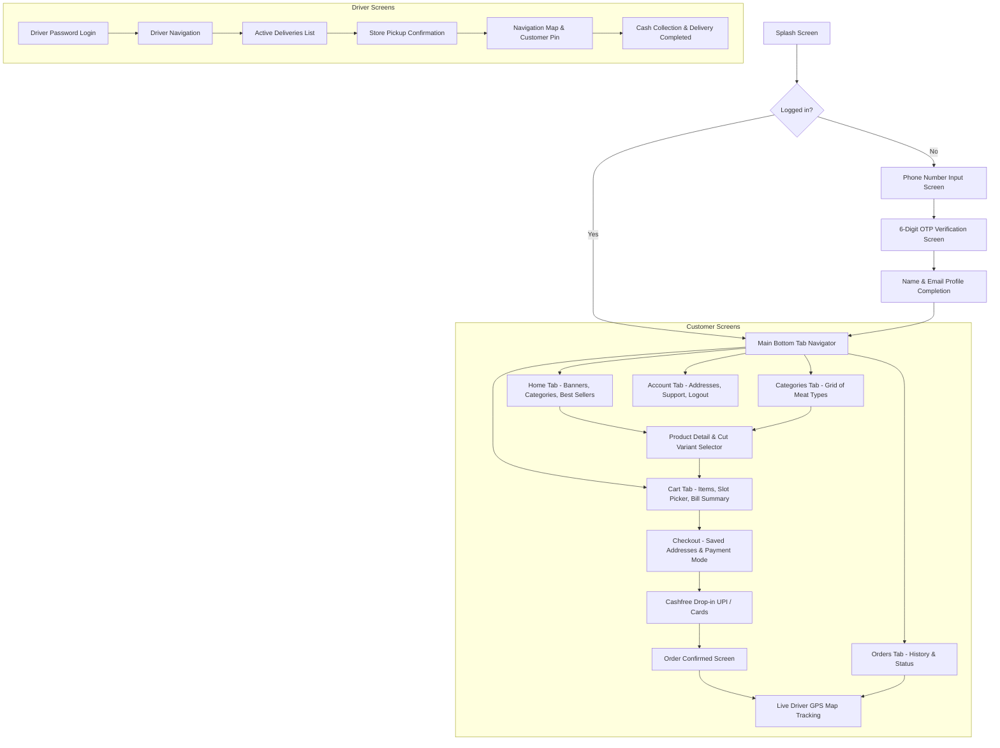

# 🎨 Daily Meat — UI/UX Design & Frontend Handover Document

> **Document Version:** 1.0.0  
> **Target Audience:** UI/UX Designers, React Native / Frontend Freelance Engineers  
> **Mobile App Codebase:** `daily-meat-app-new` (React Native / Expo TypeScript)  
> **Custom URL Scheme:** `dailymeat://`  

---

## 🎨 1. Brand Identity & Design System Tokens

### 1.1 Color Palette

| Token Name | Hex Code | Preview | Usage |
| :--- | :--- | :---: | :--- |
| **Brand Primary** | `#6C210A` | 🟫 | Header banners, primary action buttons, active tab indicators |
| **Brand Secondary** | `#8B2C0E` | 🟥 | Hover states, gradients, promotional badges |
| **Accent / Sale** | `#E76F51` | 🟧 | Discount tags, flash sale stickers, countdown clocks |
| **Success / Fresh** | `#2A9D8F` | 🟩 | In-stock badges, completed orders, delivered status |
| **Warning / Pending** | `#E9C46A` | 🟨 | Preparing orders, COD awaiting collection |
| **Danger / Cancelled**| `#E63946` | 🟥 | Out-of-stock badges, cancelled orders, delete warnings |
| **Dark Surface** | `#121212` | ⬛ | Dark mode background |
| **Light Surface** | `#F8F9FA` | ⬜ | Light mode background |
| **Card White** | `#FFFFFF` | ⬜ | Clean product card container |

### 1.2 Status Badge Color Codes

| Order Status | Badge Background | Badge Text |
| :--- | :--- | :--- |
| `PENDING` | `#FFF3CD` | `#856404` |
| `CONFIRMED` | `#D1ECF1` | `#0C5460` |
| `PREPARING` | `#E2E3E5` | `#383D41` |
| `READY_FOR_PICKUP` | `#D4EDDA` | `#155724` |
| `OUT_FOR_DELIVERY` | `#E8DAEF` | `#5B2C6F` |
| `DELIVERED` | `#D4EDDA` | `#155724` |
| `CANCELLED` | `#F8D7DA` | `#721C24` |

### 1.3 Typography
- **Primary Font Family:** `Inter`, `Segoe UI`, `Roboto`
- **Heading 1 (Hero / Brand):** 28px, Bold (800), Line Height 34px
- **Heading 2 (Section Title):** 20px, Semi-Bold (700), Line Height 26px
- **Subheading (Product Name):** 16px, Medium (600), Line Height 22px
- **Body Text:** 14px, Regular (400), Line Height 20px
- **Microcopy / Weight Labels:** 12px, Regular (400), Color `#6C757D`

---

## 📱 2. Mobile App Screen Map & Navigation Tree

---

## 🧭 3. Screen-by-Screen Functional Specifications

### 3.1 Customer App
1. **Phone Number & OTP Screen (`/auth/login`):**
   - Clean, centered interface with Daily Meat brand logo.
   - Phone input with default `+91` prefix.
   - Auto-focuses next digit box for OTP; auto-detects incoming SMS using Android SMS Retriever API.
2. **Home Screen (`/home`):**
   - Top Bar: Delivery location address selector with distance indicator.
   - Hero Carousel: Promotional banners fetched from `GET /api/catalog/banners`.
   - Category Circles: Circular cards with meat icons (`Chicken`, `Mutton`, `Fish`, `Eggs`, `Combos`).
   - Best Sellers Grid: 2-column grid showing gross/net weights, cut styles, price, and floating "ADD" button.
3. **Cart & Delivery Slot Picker (`/cart`):**
   - Stepper item counter `[-] 1 [+]` with item instructions.
   - Horizontal date picker (`Today`, `Tomorrow`, `Pick a Date`).
   - Slot chips: Shows available time slots (`07:00 AM - 09:00 AM`, `11:00 AM - 01:00 PM`) fetched from `GET /api/orders/slots`.
   - Coupon input bar with "Apply" button and savings indicator.
4. **Live Order Tracking Screen (`/orders/track/:id`):**
   - Google Maps view showing customer destination pin, store pin, and live moving driver bike marker.
   - Subscribes to Socket.IO `order_<id>` room and renders smooth marker transitions based on `orderLocationUpdate`.

### 3.2 Driver App
1. **Driver Dashboard (`/driver/dashboard`):**
   - Duty toggle: Active / Offline switch.
   - Today's completed delivery counter and pending orders count.
2. **Order Pickup & Route Screen (`/driver/orders`):**
   - Order cards with customer phone button (click-to-call) and delivery slot window.
   - Action buttons: "Mark Picked", "Out for Delivery", "Delivered".
   - If order is COD, displays bold amber box: *"Collect ₹XXX in Cash from Customer"*.

---

## 🔗 4. Deep Linking URL Scheme Specifications

The app responds to custom deep link scheme `dailymeat://`:
- `dailymeat://home`: Navigates to home tab.
- `dailymeat://category/:id`: Opens catalog filtered by category ID.
- `dailymeat://product/:id`: Opens product detail page.
- `dailymeat://order/:id`: Opens order details / live tracking.
- `dailymeat://payment-success?order_id={id}`: Cashfree payment return URL.

