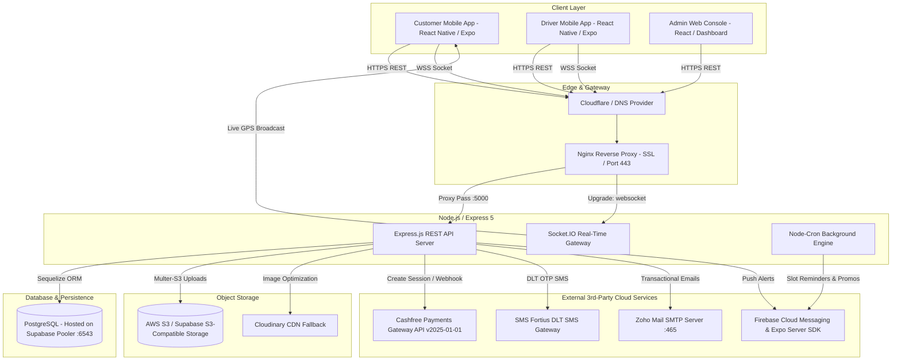
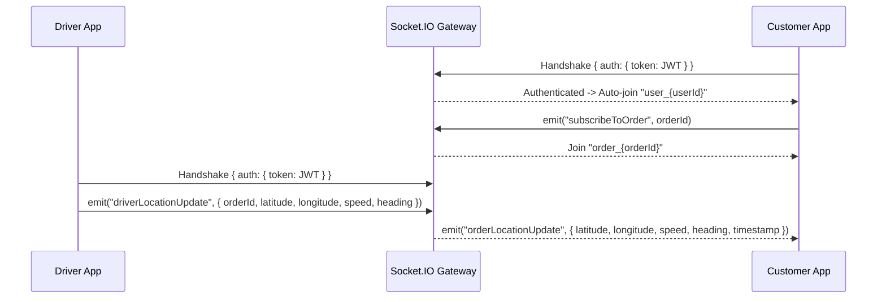

# 🏛️ Daily Meat — High-Level Design (HLD) Document

> **Document Version:** 1.0.0  
> **Target Audience:** Freelance Engineers, Full-Stack Developers, DevOps & Technical Leads  
> **Last Updated:** October 2026  
> **Platform Status:** Production-Ready  

---

## 📌 1. Executive Summary & Platform Scope

**Daily Meat** is an on-demand, hyper-local fresh meat and poultry supply chain platform operating in Hyderabad, India. The platform bridges three distinct user groups:

1. **Customers (Mobile App):** Order fresh cuts, boneless varieties, and specialty poultry with customized delivery slots or express delivery. Track delivery partner in real-time on live map.
2. **Delivery Partners / Drivers (Mobile App):** View assigned deliveries, accept/reject assignments, batch-pickup orders from store hub, navigate to customer destination, broadcast live GPS updates, and settle COD cash collections.
3. **Store Administrators (Web Console):** Manage product catalog, cut variants, pricing, stock levels, deliverable pincodes, delivery slots, manual telephone orders, automated driver assignments, and vendor procurement bills.

---

## 🏗️ 2. High-Level System Architecture

The following diagram illustrates how all components communicate:

---

## 💻 3. Technology Stack & External Integrations

| Tier / Service | Technology Used | Version | Purpose |
| :--- | :--- | :--- | :--- |
| **Backend Runtime** | Node.js (CommonJS) | `>= 18.x` / LTS | High-throughput asynchronous event loop |
| **Web Framework** | Express.js | `^5.2.1` | REST routing, HTTP middleware, error handling |
| **Database** | PostgreSQL | `v15+` | Relational database hosted on Supabase (`wgiagtzzacijwvnkfdyt`) |
| **ORM** | Sequelize | `^6.37.8` | Model associations, migrations, row locking & transactions |
| **Real-Time Gateway** | Socket.IO | `^4.8.3` | Live driver GPS tracking and room-based order alerts |
| **Payment Gateway** | Cashfree Payments | API `2025-01-01` | Seamless UPI Intent, Cards, NetBanking, auto-verification & refunds |
| **Push Notifications** | Firebase Admin & Expo SDK | `expo-server-sdk ^6.1.0` | Transactional order alerts & marketing re-engagement |
| **SMS Gateway** | SMS Fortius | DLT HTTP API | 6-digit phone login OTPs with Android auto-read hash |
| **Email Service** | Nodemailer | `nodemailer ^8.0.11` | Order receipts and support alerts over Zoho SMTP (`465`) |
| **Object Storage** | Supabase S3 / AWS S3 | `@aws-sdk/client-s3` | Product images, banners, and uploads |
| **Fallback Storage** | Cloudinary | `^1.41.3` | Redundant cloud asset storage |
| **Task Scheduling** | Node-Cron | `^4.2.1` | Slot alerts & 7-day user re-engagement routines |
| **API Documentation**| Swagger OpenAPI 3.0 | `swagger-ui-express` | Interactive API documentation at `/api-docs` |
| **Testing Collection**| Postman | Collection v2.1.0 | 100 pre-configured requests in `Daily_Meat_API.postman_collection.json` |

---

## 🔐 4. Security & Authentication Architecture

1. **Dual-Layer Token Authentication:**
   - **Access Token:** Short-lived JWT signed with `JWT_SECRET` containing `{ id, phone, role }`. Passed in `Authorization: Bearer <token>`.
   - **Refresh Token:** Long-lived JWT signed with `REFRESH_TOKEN_SECRET`. Stored directly in `User.refresh_token` database column to allow instant server-side revocation on logout.
2. **Role-Based Access Control (RBAC):**
   - `CUSTOMER`: Access to catalog, addresses, checkout, order history, support.
   - `DRIVER`: Access to assigned pickup routes, status progressions, live location emission.
   - `ADMIN`: Unrestricted access to metrics, inventory, customer search, manual orders, billing.
3. **Dual Authentication Flows:**
   - **Customers:** Authenticate via phone OTP (SMS Fortius) or email OTP. Passwords are not required.
   - **Staff (Admin & Driver):** Authenticate using phone/email and bcrypt-hashed password (salt rounds = 10).
4. **Brute Force & Abuse Protection:**
   - Max 5 failed OTP attempts before OTP is invalidated.
   - 5-minute expiry timestamp enforced at database level.
   - Automated testing bypass enabled for phone numbers containing `9000000000` with static OTP `123456`.

---

## ⚡ 5. Real-Time WebSocket Communication Architecture

The Socket.IO server is mounted on the primary HTTP server and authenticated via a JWT handshake middleware:

---

## 🚀 6. Infrastructure & Deployment Topology

- **Production Server:** `https://dailymeatserver.devmetsolutions.com`
- **Reverse Proxy:** Nginx configured with `proxy_http_version 1.1`, `Upgrade $http_upgrade`, `Connection 'upgrade'`.
- **Process Manager:** PM2 running in cluster mode (`pm2 start src/server.js -i max --name daily-meat-api`).
- **Database Connection:** Connected to Supabase Transaction Pooler (`aws-1-ap-southeast-1.pooler.supabase.com:6543`) with `ssl: { rejectUnauthorized: false }`.
