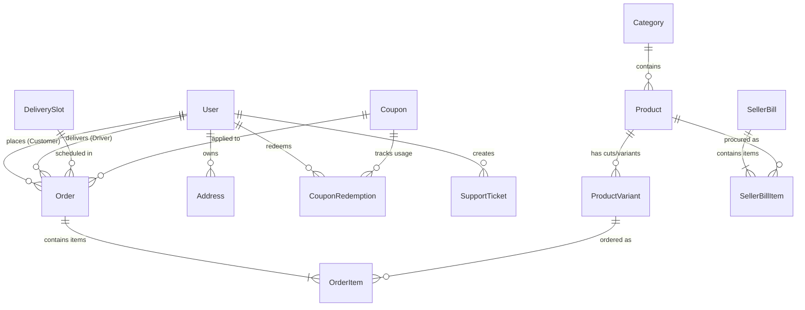
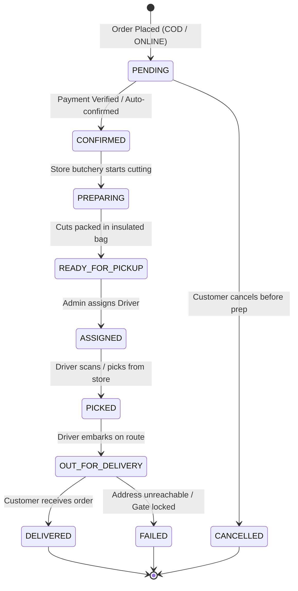
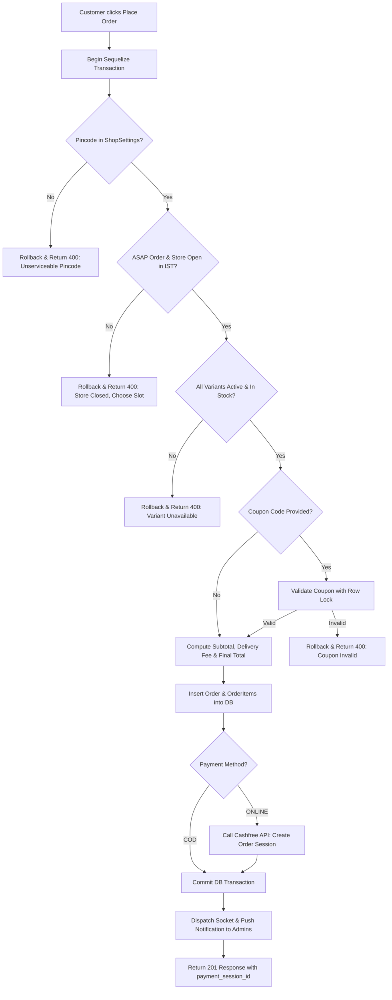

# 🔧 Daily Meat — Low-Level Design (LLD) Document

> **Document Version:** 1.0.0  
> **Target Audience:** Freelance Engineers, Backend Developers, Database Administrators  
> **Database Host:** PostgreSQL (Supabase Pooler :6543)  
> **ORM:** Sequelize 6  

---

## 🗄️ 1. Database Entity-Relationship (ER) Architecture

Sequelize manages 17 core database models configured with relational foreign keys in `src/models/index.js`:

---

## 📊 2. Database Schema Data Dictionary

### 1. `User`
Primary account entity for Customers, Delivery Drivers, and Administrators.
- `id` (INTEGER, PK, Auto-increment)
- `name` (STRING, Nullable)
- `phone` (STRING, Unique, Indexed)
- `email` (STRING, Unique, Nullable)
- `password` (STRING, Bcrypt hash, Nullable for Customers)
- `role` (ENUM: `'CUSTOMER'`, `'DRIVER'`, `'ADMIN'`, Default: `'CUSTOMER'`)
- `is_profile_completed` (BOOLEAN, Default: `false`)
- `is_active` (BOOLEAN, Default: `true`)
- `is_online` (BOOLEAN, Default: `false`, Driver duty toggle)
- `push_token` (STRING(255), Comma-separated Expo tokens)
- `device_id` (STRING, Nullable)
- `refresh_token` (TEXT, Revocable JWT string)
- `otp` (STRING(6), Nullable)
- `otp_expires_at` (DATE, Nullable)
- `otp_attempts` (INTEGER, Default: 0)

### 2. `Order`
Central transaction and fulfillment model.
- `id` (INTEGER, PK, Auto-increment)
- `user_id` (INTEGER, FK -> `User.id`)
- `driver_id` (INTEGER, FK -> `User.id`, Nullable)
- `subtotal_amount` (DECIMAL(10,2))
- `total_amount` (DECIMAL(10,2))
- `discount_amount` (DECIMAL(10,2), Default: 0)
- `delivery_charge` (DECIMAL(10,2), Default: 0)
- `total_cost` (DECIMAL(10,2), Default: 0, Snapshot of vendor cost)
- `total_profit` (DECIMAL(10,2), Default: 0)
- `delivery_date` (DATEONLY, Nullable, e.g. `'2026-10-25'`)
- `delivery_slot_id` (INTEGER, FK -> `DeliverySlot.id`, Nullable)
- `delivery_slot_label` (STRING, Nullable, e.g. `'07:00 AM - 09:00 AM'`)
- `delivery_instruction` (STRING, Nullable)
- `payment_method` (ENUM: `'COD'`, `'ONLINE'`)
- `payment_status` (ENUM: `'PENDING'`, `'PAID'`, `'FAILED'`, `'REFUNDED'`, Default: `'PENDING'`)
- `status` (ENUM: `'PENDING'`, `'CONFIRMED'`, `'PREPARING'`, `'READY_FOR_PICKUP'`, `'ASSIGNED'`, `'PICKED'`, `'OUT_FOR_DELIVERY'`, `'DELIVERED'`, `'CANCELLED'`, `'FAILED'`)
- `cf_order_id` (STRING, Cashfree Order ID)
- `payment_session_id` (STRING, Cashfree Session ID for drop-in SDK)
- `coupon_id` (INTEGER, FK -> `Coupon.id`, Nullable)
- `coupon_code_snapshot` (STRING, Nullable)
- `address_title` (STRING, Nullable)
- `address_street` (STRING)
- `address_city` (STRING)
- `address_pincode` (STRING)
- `address_latitude` (DECIMAL(10,8), Nullable)
- `address_longitude` (DECIMAL(11,8), Nullable)
- `failure_reason` (STRING, Nullable)
- `delivered_at` (DATE, Nullable)

### 3. `Product` & `ProductVariant`
- `Product`: `id`, `category_id` (FK), `name`, `description`, `image_url`, `sort_order`, `is_active`.
- `ProductVariant`: `id`, `product_id` (FK), `weight` (e.g. `'500g'`), `gross_weight` (e.g. `'650g'`), `net_weight` (e.g. `'500g'`), `price`, `discounted_price`, `cost_price`, `in_stock`, `is_active`.

### 4. `ShopSettings`
Singleton operational configuration (ID = 1).
- `shop_latitude`, `shop_longitude`: Store GPS location.
- `delivery_radius_km`: Max permissible radial distance.
- `deliverable_pincodes`: Array of serviced postal codes.
- `store_start_time`, `store_close_time`: Operational hours in IST (`"07:00"` to `"22:00"`).
- `orders_paused`: Emergency toggle to stop new incoming orders.

---

## 🔄 3. Core Business Workflows & State Machines

### 3.1 Order Progression State Machine

### 3.2 Order Checkout Pipeline (`orderController.placeOrder`)

### 3.3 Cashfree Payment Verification Pipeline

1. **Client Drop-in UI Callback (`POST /api/payments/verify`):**
   - App passes `{ order_id, cf_order_id }`.
   - Backend queries `cashfreeRequest("GET", "/orders/{orderId}")`.
   - If `order_status === 'PAID'`, order transitions to `payment_status = 'PAID'` and triggers `adminNewOrder` Socket.IO alert.
   - If payment failed/expired, the draft order is purged (`order.destroy()`) to prevent orphaned unfulfilled records.
2. **Server-to-Server Webhook (`POST /api/payments/webhook`):**
   - Asynchronously receives payment events directly from Cashfree servers.
   - Idempotently verifies and confirms orders even if the customer's phone lost network during payment redirection.

### 3.4 Live Driver GPS Tracking (`src/config/socket.js`)

1. **Client Handshake:** Socket client sends `{ auth: { token: JWT } }`. Socket middleware verifies token and joins `user_<userId>`.
2. **Order Subscription:** Client calls `socket.emit("subscribeToOrder", orderId)`. Joins room `order_<orderId>`.
3. **Location Broadcast:** Driver emits `socket.emit("driverLocationUpdate", { orderId, latitude, longitude, speed, heading })`.
4. **Room Forwarding:** Server broadcasts `socket.to("order_" + orderId).emit("orderLocationUpdate", payload)` to all tracking clients.

---

## ⏰ 4. Scheduled Background Jobs (Node-Cron)

1. **`slotNotificationCron.js` (Every minute `* * * * *`):**
   - Queries `DeliverySlot` active records.
   - Calculates time difference in Indian Standard Time (`Asia/Kolkata`).
   - If an active slot starts in **4m 30s to 5m 30s** and has unassigned/pending orders, dispatches high-priority push notification and Socket alert `admin_slot_alert` to Store Admins.
2. **`reengagementCron.js` (Daily at 10:00 AM `0 10 * * *`):**
   - Finds customers whose last order occurred exactly 7 days ago.
   - Dispatches promotional discount push alert: *"We miss you! 🥩 Treat yourself to fresh meat today."*

---

## 🚦 5. Standard HTTP Status Code & Error Handling

- `200 OK`: Successful GET or update operation.
- `201 Created`: Resource successfully created (Order placed, Category added).
- `400 Bad Request`: Validation failure (out of stock, invalid coupon, outside delivery radius).
- `401 Unauthorized`: Missing, expired, or invalid JWT Bearer token.
- `403 Forbidden`: Insufficient role privileges (e.g. non-Admin accessing admin routes).
- `404 Not Found`: Target entity ID not found.
- `500 Internal Server Error`: Uncaught database exception or 3rd-party service downtime.
